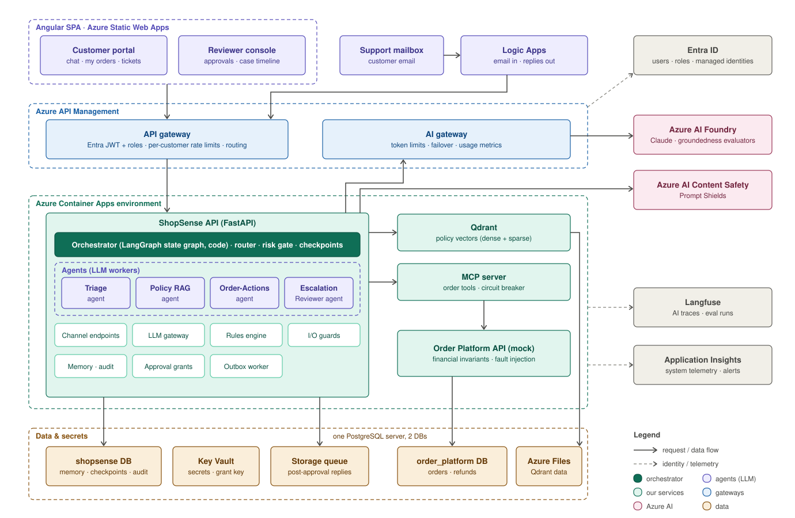
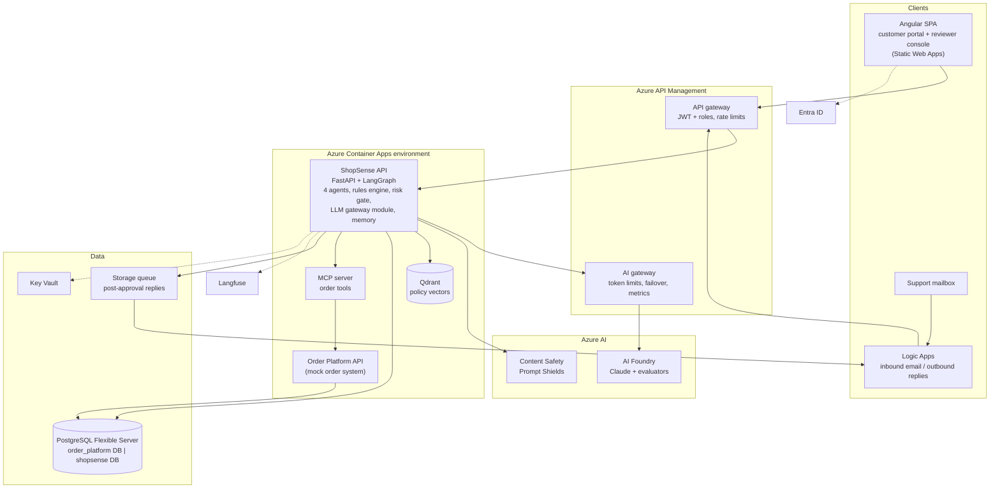
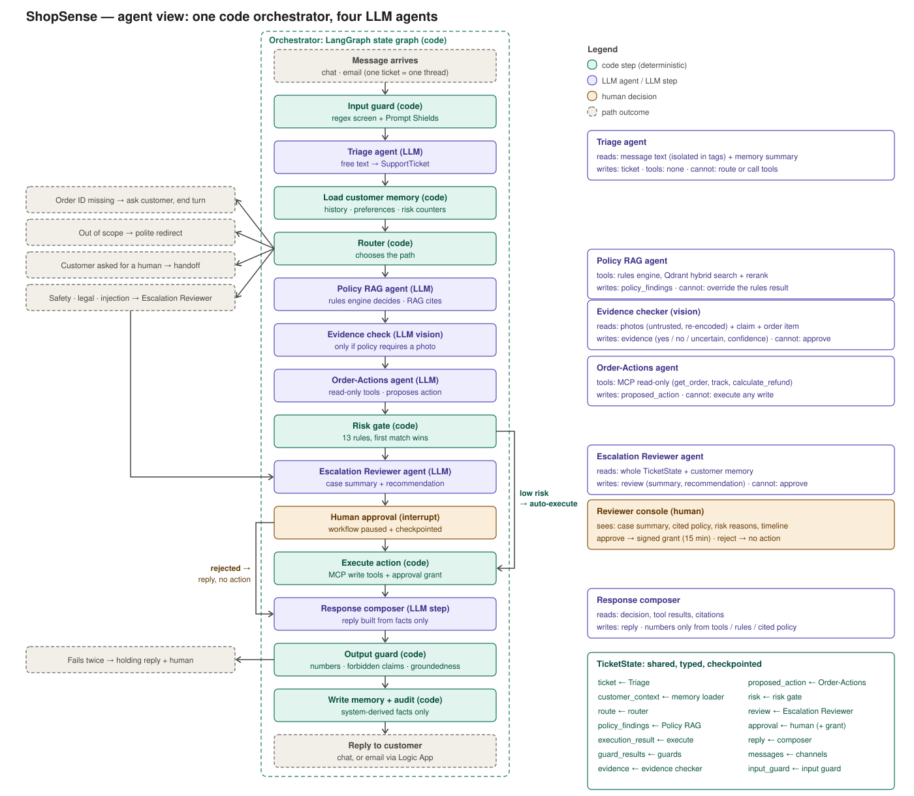
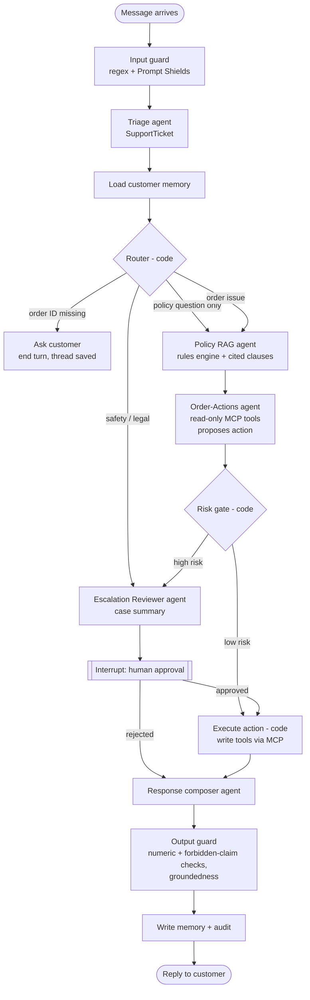
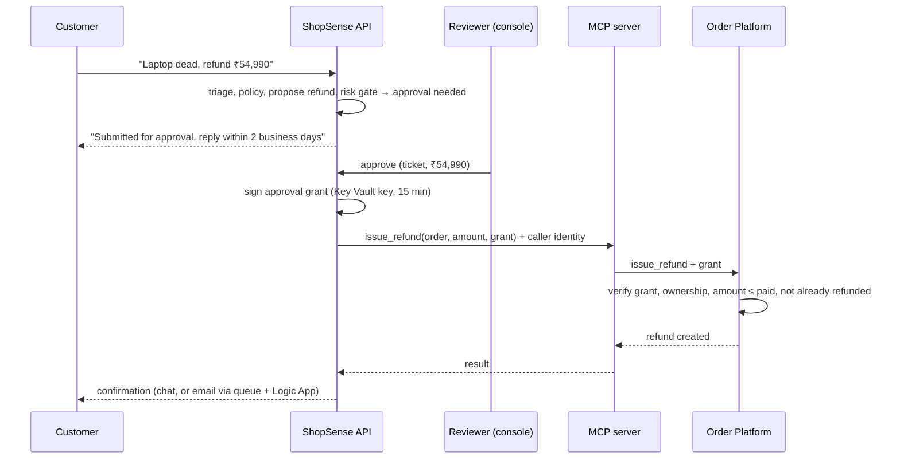

# High-Level Design

> Status: in progress. HLD complete: decisions D1–D14 accepted. Next: LLD.

## Table of contents
- [1. Architecture principles](#1-architecture-principles)
- [2. System context and components](#2-system-context-and-components)
- [3. Services](#3-services)
- [4. Data stores](#4-data-stores)
- [5. Ticket workflow](#5-ticket-workflow)
- [6. High-value refund flow](#6-high-value-refund-flow)
- [7. Email channel flow](#7-email-channel-flow)
- [8. Security model](#8-security-model)
- [9. Resilience and observability](#9-resilience-and-observability)
- [10. Component-to-milestone map](#10-component-to-milestone-map)
- [11. Open items](#11-open-items)

## 1. Architecture principles
1. **LLMs understand and explain; code decides and enforces.** Routing, eligibility, risk and execution are deterministic code.
2. **Ticket text is untrusted input.** It can never change routing, choose whose data is accessed, or trigger a write.
3. **Defence in depth.** Every threat is stopped by at least two independent layers; the last layer is never an LLM.
4. **Boundaries follow ownership.** Service boundaries match real-world ownership (support product vs order system), not code modules.
5. **Everything behind interfaces.** Model providers, evaluators and safety services are swappable by configuration.
6. **Fail closed.** When a safety dependency is unavailable, the ticket goes to a human (D12).

## 2. System context and components

Editable source: [`diagrams/hld.excalidraw`](diagrams/hld.excalidraw) (open at [excalidraw.com](https://excalidraw.com) → menu → Open).

The same view as Mermaid, for quick edits:

## 3. Services
| Service | Responsibility | Owns data | Exposed |
|---|---|---|---|
| **ShopSense API** | Channels (chat, email, approvals), orchestrator (LangGraph state graph, code), 4 agents, rules engine, risk gate, output guard, LLM gateway module, memory, audit | `shopsense` DB, Qdrant collections | Via APIM only |
| **Order Platform API** | Mock of the company order system: customers, orders, shipments, refunds. Enforces financial invariants (cap, amount paid, no double refunds, approval grants). Supports fault injection. | `order_platform` DB | Internal only |
| **MCP server** | Exposes order operations as MCP tools (read and write). Attaches caller identity; never trusts LLM-supplied identity. | None | Internal; optionally via APIM for external MCP clients |

Supporting: APIM (both gateways), Angular SPA, Logic Apps, Qdrant, PostgreSQL, Key Vault, Storage queue, Foundry, Content Safety, Langfuse, Entra ID.

## 4. Data stores
| Data | Store | Owner |
|---|---|---|
| Customers, products, orders, shipments, refunds | PostgreSQL `order_platform` | Order Platform |
| Long-term customer memory (history, preferences, risk counters) | PostgreSQL `shopsense` | ShopSense |
| Workflow checkpoints (paused tickets) | PostgreSQL `shopsense` (LangGraph Postgres checkpointer) | ShopSense |
| Approvals, audit log, tickets | PostgreSQL `shopsense` | ShopSense |
| Policy rules table (versioned) | PostgreSQL `shopsense` | ShopSense |
| Policy chunks (dense + sparse vectors) | Qdrant on Azure Files | ShopSense |
| Secrets, approval-grant signing key | Key Vault | Platform |
| Photo evidence | Azure Blob Storage (private) | ShopSense |

## 5. Ticket workflow
Deterministic backbone with agentic nodes ([D7](adr/007-agent-topology.md)). The **orchestrator is code**: a LangGraph state graph that sequences steps, routes, owns the shared `TicketState`, pauses for human approval and executes actions. The **4 agents are LLM workers** it calls; none of them decides routing or executes writes.

Editable source: [`diagrams/agents.excalidraw`](diagrams/agents.excalidraw). The same flow as Mermaid:

## 6. High-value refund flow
Large refunds need a human approval *and* a signed grant that the Order Platform verifies independently ([D10](adr/010-mcp-server-and-tool-safety.md)).

## 7. Email channel flow
1. Email arrives at the support mailbox; the Logic App drops obvious junk and calls APIM `/email` with its managed identity.
2. ShopSense API verifies the sender is a registered Entra user and that DMARC passed (authoritative check).
3. Unregistered or unverified: auto-reply, no AI processing, attempt logged.
4. Verified: ticket created or continued (subject reference `[TKT-nnnn]`); any refund requested by email always goes to approval.
5. Immediate replies are returned to the Logic App and sent in-thread. Replies after approval go onto a Storage queue that a second Logic App sends from the same mailbox.

## 8. Security model
| Concern | Control |
|---|---|
| Who is calling | Entra ID tokens validated at APIM; roles `customer` / `reviewer` |
| Whose data | Customer ID from the verified token or verified sender, attached by code; ownership checked in the Order Platform |
| Service to service | Managed-identity tokens; internal ingress for MCP server and Order Platform |
| Secrets | Key Vault via managed identity; no secrets in code or env files |
| Prompt injection | Regex screen + Prompt Shields + ticket isolation + read-only LLM tools + code-only routing |
| High-value refunds | Risk gate + human approval + signed grant verified by the Order Platform |
| Memory poisoning | Memory stores system-derived facts only, never raw customer text |
| Email spoofing | Registered sender + DMARC pass; email refunds always need approval |

The full layered map is in [D12](adr/012-guardrails.md).

## 9. Resilience and observability
Details in [D13](adr/013-resilience-and-observability.md).
- **Timeouts** on every call; ~30 s budget per chat turn.
- **Retries** (max 3, backoff with jitter) for transient errors only; writes retried only with the same idempotency key.
- **Circuit breaker** in the MCP server around Order Platform calls.
- **Fallback:** failed reads park the ticket in the human queue with a holding reply; approved writes go through an **outbox** and a retry worker, so no approved action is lost.
- **Fault injection:** internal latency and error-rate switch in the Order Platform for the M7 demo.
- **Observability:** Langfuse for AI traces (steps, model calls, tokens, cost, tools, retrieval, decisions); Application Insights for system telemetry; one trace ID across services; personal data masked before export.

## 10. Component-to-milestone map
| Milestone | Components added | Infrastructure first used |
|---|---|---|
| M1 | LLM gateway module, triage, `SupportTicket` | APIM (both gateways), Foundry, Container Apps, Entra ID |
| M2 | Order Platform API, order tools, single Order-Actions agent | PostgreSQL `order_platform` |
| M3 | Customer memory, policy ingestion, Qdrant index, rules table | Qdrant, PostgreSQL `shopsense` |
| M4 | Hybrid search, reranking, consistency check, groundedness evaluation | Foundry evaluators |
| M5 | LangGraph workflow, risk gate, human-approval interrupt, checkpoints, reviewer API | Checkpoint tables |
| M6 | 4 agents, MCP server, chat + email channels, Angular SPA | Logic Apps, Storage queue, Static Web Apps |
| M7 | Langfuse tracing, retries, circuit breaker, human-queue fallback, fault injection | Langfuse, APIM AI-gateway policies |
| M8 | Prompt Shields, output guard, approval grants hardening, golden eval, demo endpoint | Content Safety |

## 11. Open items
| # | Topic |
|---|---|
| Diagrams | Add Blob Storage and the evidence-check step ([LLD-6](lld/06-rules-engine-and-retrieval.md#photo-evidence)) after LLD-9 |
| LLD | Per-component design: interfaces, `TicketState` schema, data models, tool contracts, prompts, error handling |
