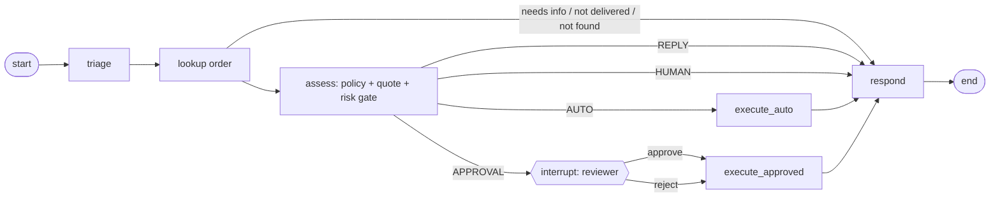

# M5 — LangGraph workflow

> **Brief:** LangGraph workflow: triage → policy-check → action execution → conditional routing (auto-resolve low-risk, human-approval interrupt for high refunds or angry-customer sentiment), with checkpointing.

## Table of contents
- [What was built](#what-was-built)
- [How it maps to the brief](#how-it-maps-to-the-brief)
- [The graph](#the-graph)
- [Design choices](#design-choices)
- [Setup](#setup)
- [Run](#run)
- [Results](#results)
- [Known gaps](#known-gaps)

## What was built
| Piece | Location |
|---|---|
| Risk gate (pure code): REPLY, AUTO, APPROVAL, HUMAN; cap ₹5,000; angry or critical customers and risk flags | `services/shopsense_api/src/shopsense_api/domain/workflow/risk.py` |
| Workflow steps (triage, lookup, assess, execute, respond); writes only in the two execute steps | `.../application/workflow/flow.py` |
| Workflow state (plain, JSON-serialisable) | `.../application/workflow/state.py` |
| LangGraph adapter: graph wiring and the approval `interrupt()` | `.../adapters/workflow/langgraph_ticket.py` |
| Runner: start, inspect and resume a ticket by its thread ID | `.../adapters/workflow/runner.py` |
| Postgres checkpoints (`AsyncPostgresSaver` in the shopsense database) | `.../entrypoints/workflow_cli.py` |
| Order Platform: reviewer decision on a pending refund (`POST /v1/refunds/{refund_no}/decision`) | `services/order_platform/` |
| `shopsense-workflow` CLI: `start`, `status`, `resume --approve` / `--reject` | `.../entrypoints/workflow_cli.py` |
| Routing evaluation: 11 tickets, route and outcome checked, and writes counted | `evals/data/routing.jsonl`, `shopsense-eval routing` |
| Tests: risk gate, every route, approval resume and rejection, checkpoint survives a new graph instance, write refused outside AUTO | `services/shopsense_api/tests/unit/test_workflow_m5.py` (19 tests) |
| Demo: each step is a separate process | `milestones/m5/demo.py` |

## How it maps to the brief
| Brief | Implementation |
|---|---|
| Triage | Triage use case (M1) produces a validated `SupportTicket` |
| Policy check | Rules engine (M4) decides eligibility, with a cited section |
| Action execution | Code, not the model: `calculate_refund`, then `request_refund` (AUTO) or the approval path |
| Conditional routing | Risk gate: auto-resolve for a calm, in-cap refund; approval interrupt above the cap or for an angry customer |
| Human-approval interrupt | `interrupt()` in the approval node. The run pauses and its state is checkpointed |
| Checkpointing | Postgres checkpointer, so a paused ticket resumes from a different process |
| Approval resume via CLI | `shopsense-workflow resume --ticket … --approve --reviewer …` |

## The graph


## Design choices
| Decision | Choice | Why |
|---|---|---|
| Who decides the route? | The risk gate in code, from the triage fields, the eligibility and the amount | D10: the model never routes or executes a write |
| Where does a write happen? | Only in `execute_auto` and `execute_approved`. `execute_auto` refuses to run outside the AUTO route | "No write without passing the risk gate" is enforced in code and tested |
| When does the approval pause? | Before any write, so a rejected request writes nothing | A held refund must not be written first and reversed later |
| Idempotency | Refund key = hash(ticket, SKU, amount, stage) | A retried step replays the same refund |
| Above the cap | Order Platform holds the refund as `pending_approval`; the reviewer decision settles it (`processed`) and counts it against the item | The money invariant stays in the Order Platform (LLD-7) |
| LangGraph | An adapter over the application steps (LLD-1) | The steps are testable without LangGraph |
| Checkpointer | `AsyncPostgresSaver` with the Entra token (LLD-3) | Survives process restarts |

## Setup
1. Install (`uv sync --all-packages`). Adds `langgraph`, `langgraph-checkpoint-postgres` and `psycopg`.
2. Start the Order Platform on port 8001 (`uv run uvicorn order_platform.entrypoints.api:app --port 8001`).
3. The shopsense database (M3) is used for the checkpoints. The LangGraph tables are created on first run.

## Run
```bash
uv run shopsense-workflow start --ticket TKT-1 --customer C0002 --message "My laptop ORD-100003 is dead. Refund Rs 54,990."
uv run shopsense-workflow status --ticket TKT-1
uv run shopsense-workflow resume --ticket TKT-1 --approve --reviewer your-name
uv run shopsense-eval routing --runs 1          # routing suite (reseeds before each run)
uv run python milestones/m5/demo.py             # the full walk-through, each step a new process
uv run pytest                                    # unit tests
```

## Results
Raw evidence: [`results/`](results/RESULTS.md).

| Check | Result |
|---|---|
| Routing suite (11 tickets, live triage and Order Platform) | **11 of 11** routes and outcomes correct |
| Write gate (writes counted per ticket) | **PASS**: every write happened only in a ticket that expected one |
| Checkpoint round trip (paused in one process, resumed in another) | **PASS** (demo steps 2–3) |
| Unit tests (risk gate, every route, checkpoint, write guard) | 19 pass |

## Known gaps
- **Reviewer identity is not verified.** The decision endpoint is internal and the `reviewer` name is recorded only in the workflow. Signed approval grants and reviewer roles come with M6 (reviewer console) and M8 (grants).
- **Single approval per ticket.** A second approval request on the same ticket is not modelled.
- **Customer replies are templates.** The LLM writes the triage only; replies are fixed text. The grounded policy text comes from the M4 decision.
- **Timeouts after a write.** If the order system times out after a refund was created, the step hands off rather than retrying blindly. Full reconciliation (outbox) is M7.
