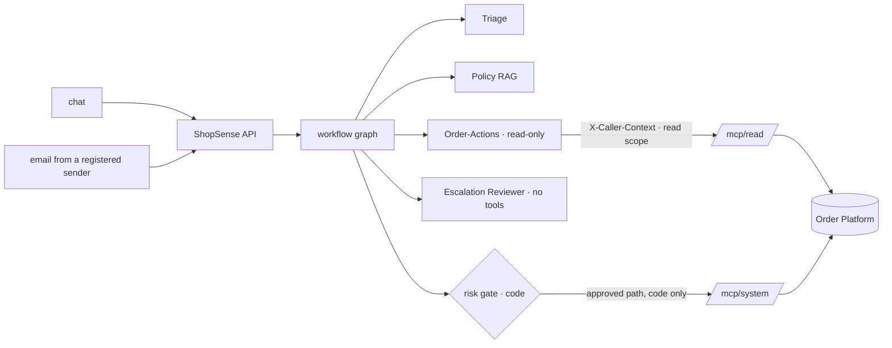

# M6 — Multi-agent team, MCP server and channels

> **Brief:** Multi-agent team (Triage, Policy RAG, Order-Actions, Escalation Reviewer) with an MCP server exposing order/refund/shipping mock APIs so the same tools work across chat and email channels.

## Table of contents
- [What was built](#what-was-built)
- [How it maps to the brief](#how-it-maps-to-the-brief)
- [The team and the boundary](#the-team-and-the-boundary)
- [Design choices](#design-choices)
- [Setup](#setup)
- [Run](#run)
- [Results](#results)
- [Known gaps](#known-gaps)

## What was built
| Piece | Location |
|---|---|
| MCP server: read endpoint (`/mcp/read`) and system endpoint (`/mcp/system`) on the official `mcp` SDK | `services/mcp_server/` |
| Caller context: HMAC-SHA256, 5-minute expiry, scope claim; shared by both services | `libs/contracts/src/shopsense_contracts/caller_context.py` |
| Caller-context middleware: refuses a forged, expired or wrong-scope token before any tool runs | `services/mcp_server/src/mcp_server/auth.py` |
| Five read tools and three system tools; no tool takes a customer ID | `services/mcp_server/src/mcp_server/tools.py` |
| MCP client adapter implementing the `OrderTools` port | `services/shopsense_api/src/shopsense_api/adapters/orders/mcp_order_tools.py` |
| Four agents as graph nodes: Triage (LLM), Policy RAG (rules engine + cited answer), Order-Actions (read-only LLM), Escalation Reviewer (LLM, no tools) | `application/agents/`, `application/workflow/flow.py`, `adapters/workflow/langgraph_ticket.py` |
| Channels: chat (`POST /v1/chat/tickets`) and email (`POST /v1/channels/email/inbound`), one workflow behind both | `services/shopsense_api/src/shopsense_api/adapters/http/channels_api.py`, `entrypoints/api.py` |
| Email rule: a refund from email always goes to a reviewer; only registered senders are processed | `domain/workflow/risk.py`, `data/registered_senders.json` |
| Tests: caller context, endpoint scopes, tool surface, error mapping, channels, parity | `services/mcp_server/tests/`, `services/shopsense_api/tests/unit/test_channels_m6.py` |
| Channel-parity evaluation over HTTP against the live API | `evals/data/channel_parity.jsonl`, `shopsense-eval parity` |
| Demo | `milestones/m6/demo.py` |

## How it maps to the brief
| Brief | Implementation |
|---|---|
| Triage agent | Triage (M1 use case) produces a validated `SupportTicket` |
| Policy RAG agent | Rules engine (M4) decides eligibility; `AnswerPolicyQuestion` (M3/M4) answers policy questions with citations |
| Order-Actions agent | Read-only LLM agent over the MCP read endpoint; explains the case, cannot write |
| Escalation Reviewer agent | LLM with no tools; writes a brief that is shown to the human reviewer with the approval request |
| MCP server exposing order, refund and shipping APIs | Five read tools and three system tools over the Order Platform |
| The same tools work across chat and email | Both channels call the same graph and the same MCP tools |

## The team and the boundary


## Design choices
| Decision | Choice | Why |
|---|---|---|
| Customer identity | Signed caller context, set by our code; no tool takes a customer ID | A model cannot name another customer's order by changing an argument |
| Endpoint scopes | `/mcp/read` accepts `tools.read` only; `/mcp/system` accepts `tools.system` only | An agent cannot reach a write, even by calling the endpoint directly |
| Writes | Still executed by code after the risk gate (D10) | The agent proposes nothing that is written |
| Email | Refunds always wait for a reviewer; only registered senders are processed; a re-delivered message is not processed twice | D8d and the idempotent message ID |
| Reviewer brief | Advisory; the decision stays with a person | The model informs but never executes |
| Parity | The same eligibility and rule on both channels, tested over HTTP | Channel parity is measured, not assumed |

## Setup
1. `uv sync --all-packages` (adds `mcp` v1, pinned below 2.0, and the `mcp-server` and `shopsense-contracts` packages).
2. Run three services (each in its own terminal):
   ```bash
   uv run uvicorn order_platform.entrypoints.api:app --port 8001
   uv run uvicorn mcp_server.app:app --port 8100
   uv run uvicorn shopsense_api.entrypoints.api:app --port 8000 --loop shopsense_api.entrypoints.loop:selector_loop
   ```
   The `--loop` option is needed on Windows only: psycopg's async mode does not run on the default Proactor loop.
3. The MCP server and the API share `MCP_CONTEXT_KEY` / `SHOPSENSE_CONTEXT_KEY`. The development default is in code; in Azure it comes from Key Vault.

## Run
```bash
uv run shopsense-eval parity --runs 1      # five tickets, each through chat and email
uv run python milestones/m6/demo.py        # channels, the boundary, the tools offered
uv run pytest                              # unit tests (mcp_server and shopsense_api)
```

## Results
Raw evidence: [`results/`](results/RESULTS.md).

| Check | Result |
|---|---|
| Channel parity (5 tickets, chat and email, live) | **5 of 5** correct: same eligibility and rule on both channels; chat auto where policy allows; email always waits for a reviewer; no email refund reached an automatic write |
| Read token on the system endpoint | **403** |
| Forged token on the read endpoint | **401** |
| System token on the system endpoint | 200 |
| Writes offered to the Order-Actions agent | none (`request_refund`, `request_replacement` withheld) |
| Unit tests (mcp_server, channels, workflow) | all pass (full suite: 223 passed) |

## Known gaps
- **Azure deployments not done.** The MCP server is run locally. The Container App, the Logic App on a support mailbox (OAuth consent needed from the owner) and the Storage queue for replies are deferred. The email channel is exercised by posting the same payload a Logic App would send.
- **Reviewer identity is recorded, not verified.** The decision endpoint accepts a reviewer name; roles and signed approval grants come with M8.
- **Order-Actions result is advisory.** Its reply and reason are kept with the case; the customer-facing reply still comes from the deterministic path.
- **M2 and M5 evidence predates these changes.** The MCP tools and the read-only advisor now sit under the same workflow. The final evaluation at M8 reruns every suite.
