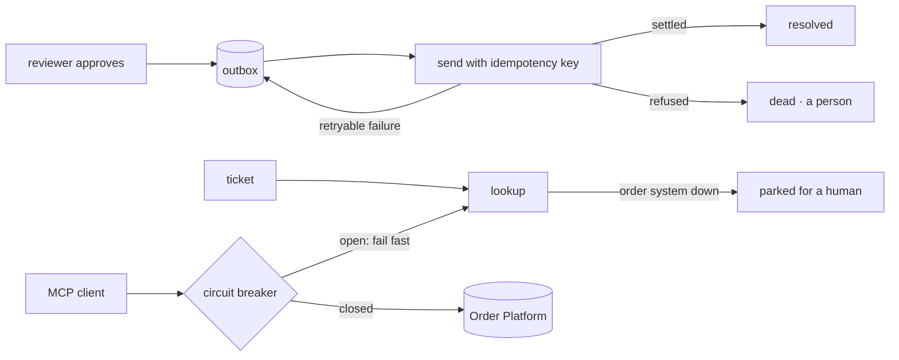

# M7 — Tracing and reliability

> **Brief:** LangFuse tracing of ticket-resolution flows; reliability hardening for order-system API flakiness (retries, fallback to human queue, circuit breaker).

## Table of contents
- [What was built](#what-was-built)
- [How it maps to the brief](#how-it-maps-to-the-brief)
- [How a failure travels through the system](#how-a-failure-travels-through-the-system)
- [Design choices](#design-choices)
- [Setup](#setup)
- [Run](#run)
- [Results](#results)
- [Known gaps](#known-gaps)

## What was built
| Piece | Location |
|---|---|
| Fault injection on the Order Platform: admin-only, errors or delays on `/v1` only, expires by itself, duration capped at 15 min | `services/order_platform/src/order_platform/adapters/http/faults.py` |
| Circuit breaker (opens after 3 consecutive retryable failures; half-open after 10 s; one probe) | `services/mcp_server/src/mcp_server/resilience.py` |
| Retries with bounded backoff for reads and keyed writes; unkeyed writes never retried | `services/mcp_server/src/mcp_server/order_client.py` |
| Breaker status for operators: `GET /health/breaker` on the MCP server (no customer data) | `services/mcp_server/src/mcp_server/app.py` |
| Tracing port; one span per workflow node (masked input and output, duration, status) | `services/shopsense_api/src/shopsense_api/application/ports/tracing.py`, `adapters/workflow/tracing.py` |
| Local JSONL trace (always on) and Langfuse ingestion adapter (on when keys are set) | `adapters/tracing/jsonl.py`, `adapters/tracing/langfuse.py`, `composite.py` |
| PII masking before anything is traced: email, Indian mobile, long digit runs, PAN | `services/shopsense_api/src/shopsense_api/domain/guardrails/masking.py` |
| Human-queue fallback: a ticket whose order system is down is parked (`parked_human_queue`) | `application/workflow/flow.py` |
| Outbox for approved writes (table `outbox_items`, Alembic revision `a1c4e7d2b9f0`); idempotent enqueue | `application/ports/outbox.py`, `adapters/db/sql_stores.py`, `adapters/db/migrations/versions/a1c4e7d2b9f0_outbox.py` |
| Outbox worker: sends pending writes with their idempotency key until they settle (`shopsense-outbox drain`) | `application/use_cases/drain_outbox.py`, `entrypoints/outbox_cli.py` |
| Tickets read their settlement from the outbox (a queued refund becomes "resolved" once the worker settles it) | `adapters/workflow/runner.py` |
| Resilience evaluation: a scripted outage against the live services, with gates | `evals/src/shopsense_evals/resilience.py`, `shopsense-eval resilience` |
| Tests: breaker transitions, retries and fast fail, masking, spans, outbox drain rules, parking, outage paths, fault injection | `services/mcp_server/tests/unit/test_resilience_m7.py`, `services/shopsense_api/tests/unit/test_reliability_m7.py`, `services/order_platform/tests/unit/test_faults_m7.py` |
| Demo: the outage as the customer and reviewer see it | `milestones/m7/demo.py` |

## How it maps to the brief
| Brief | Implementation |
|---|---|
| LangFuse tracing of ticket flows | One span per workflow node, every ticket. Local JSONL always; Langfuse ingestion when `SHOPSENSE_LANGFUSE_*` keys are set (see Known gaps) |
| Retries for order-system flakiness | Reads and keyed writes retried twice with backoff. A transient 503 is recovered (scenario A) |
| Circuit breaker | Opens after three consecutive failures; calls fail fast; probes after 10 s; closes on success (scenario B) |
| Fallback to a human queue | A ticket whose order system is down is parked with a clear reply (scenario C) |
| No approved action is lost | Approved writes are recorded in the outbox first; the worker settles them once the order system returns (scenario D) |

## How a failure travels through the system


## Design choices
| Decision | Choice | Why |
|---|---|---|
| Where retries live | In the MCP server, next to the order system | One place to tune and observe; the agent sees a single, classified error |
| What is retried | Reads, and writes that carry an idempotency key. Never an unkeyed write | A replayed keyed write returns the original result, so a retry cannot refund twice |
| What counts as a failure | Only retryable errors (timeouts, unavailable, 5xx). A refusal such as NOT_FOUND means the system answered | A bad order number must not open the breaker |
| Approved writes | Recorded in the outbox before sending | A timeout after approval cannot lose the approval |
| Dead items | A refusal that is not retryable goes to a person, never retried blindly | Stops an automatic loop on something that will never succeed |
| Lost responses | A decision that already settled is detected by reading the refund status, and marked done | Avoids a false failure after a lost response |
| Tracing failures | A failing trace sink is logged and dropped; it never changes a ticket | Observability must not become a new failure mode |
| Masking | Applied before any trace is written, locally or to Langfuse | Traces leave the process when Langfuse is on |
| Fault injection | Admin token required, expires by itself, off by default | A forgotten fault cannot stay on |

## Setup
1. `uv sync --all-packages`, then migrate the shopsense database (adds `outbox_items`): `uv run shopsense-ingest`.
2. Start the Order Platform with an admin token (`ORDER_PLATFORM_ADMIN_TOKEN`), the MCP server, and the API. Export the same token in the shell that runs the demo or the evaluation.
3. Optional, for Langfuse: set `SHOPSENSE_LANGFUSE_HOST`, `SHOPSENSE_LANGFUSE_PUBLIC_KEY` and `SHOPSENSE_LANGFUSE_SECRET_KEY` (the owner's keys; not stored in the repo).

## Run
```bash
uv run shopsense-outbox drain                  # send pending approved writes once
uv run shopsense-outbox drain --loop           # keep draining (run as the worker)
set ORDER_PLATFORM_ADMIN_TOKEN=...             # the same token the Order Platform was started with
uv run shopsense-eval resilience               # scripted outage, gates
uv run python milestones/m7/demo.py            # the outage, step by step, with the trace
```

## Results
Raw evidence: [`results/`](results/RESULTS.md).

| Gate | Result |
|---|---|
| The breaker opens under a sustained outage | **PASS** (open after three failures) |
| A ticket during the outage is parked for a human | **PASS** |
| An approved refund during the outage is queued, not lost | **PASS** (`queued_for_retry`) |
| The approved refund reaches the order system exactly once after recovery | **PASS** (refunded amount equals the paid amount) |
| No approved action is lost (outbox empty at the end) | **PASS** |
| Breaker closes after recovery | **PASS** |
| Transient errors (50%) recovered by retries | **Partly**: 3 of 10 reads succeeded. The breaker tripped during that phase and failed the rest fast; see Known gaps |

Unit tests for M7 pass (MCP resilience, reliability, fault injection, and the full workspace suite).

## Known gaps
- **Langfuse not verified live.** The adapter posts spans to the Langfuse public ingestion endpoint; the account keys are the owner's, so no live Langfuse trace is shown here. Local JSONL traces are verified.
- **Breaker trips during transient errors.** With 50% errors, three consecutive failures are enough to open the breaker, so later reads fail fast. A higher threshold or a sliding-window rate would recover more reads at 50%. Left as measured.
- **The worker is run by hand here.** In Azure it runs as a Container App with the queue trigger; that is deferred with the other Azure items (M6, M8).
- **Application Insights and the APIM AI gateway** are enhancements, not part of this milestone.
